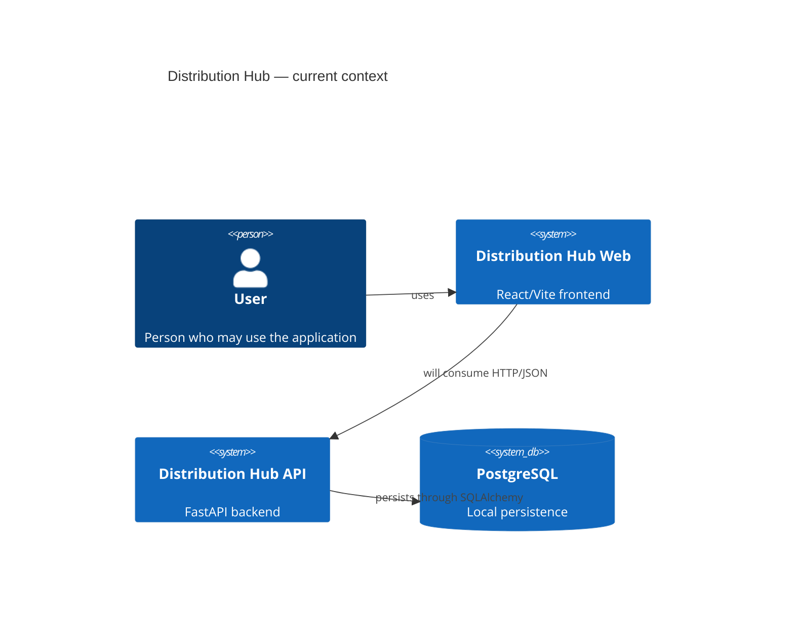
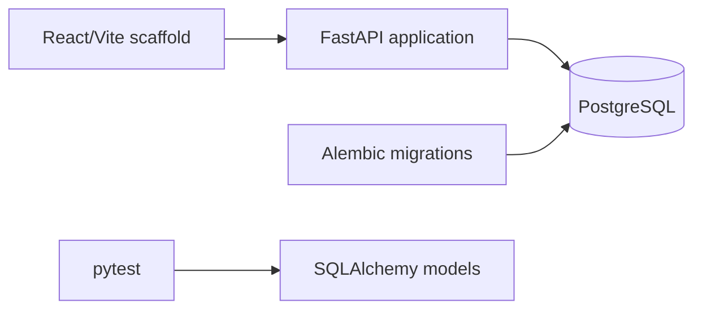

# Architecture

## Context

Distribution Hub is planned as a web application for commercial management by organizations that need to manage customers and, later, catalog, inventory, orders, and receivables. The API and frontend are independent repositories.

## Current architecture



The frontend is currently a scaffold and the API currently registers only `GET /health`. Commercial communication between the applications does not exist yet.

## Current components



The API contains configuration in `app/core`, persistence in `app/db`, and reserved directories in `app/modules`. The existence of those directories does not mean that the modules are implemented.

## Backend

The application uses a modular-monolith direction. The current entrypoint is `app/main.py`. Configuration is loaded through `pydantic-settings`; persistence uses SQLAlchemy; and the database schema is versioned with Alembic.

The existing models are `User`, `Tenant`, `TenantUser`, and `Customer`. No HTTP routers, request/response schemas, domain services, or authorization dependencies are implemented for these models yet.

### Intended dependency direction

When HTTP modules are implemented, the expected direction is:

```text
HTTP router → schema/validation → business service/rule → persistence/model
```

Business modules must not depend on frontend details. Data access must always respect the authorized tenant in the request context.

## Multi-tenant domain

The domain defines `Tenant` as the boundary for commercial data. `TenantUser` associates global users with tenants and stores the role and membership status. This rule is represented in the data model, but HTTP authentication and authorization are not implemented yet.

## Intended architecture

The first functional delivery should allow an authorized user to manage customers inside a tenant. After that flow is complete, catalog, inventory, orders, receivables, and indicators may be added, each with its own models, endpoints, tests, and screens.

Production authentication, active-tenant transport, detailed authorization, and API versioning remain undecided. There are no configured microservices, production deployment, advanced observability, or high-availability mechanisms.

## Component status

| Component | Status |
|---|---|
| React/Vite frontend | Initial scaffold |
| FastAPI | Implemented with `/health` |
| SQLAlchemy | Implemented for four entities |
| Local PostgreSQL | Configured through Docker Compose |
| Alembic | Six migrations present |
| Authentication | Not implemented |
| Multi-tenant authorization | Not implemented in the API |
| Customer CRUD | Not implemented |
| Catalog, inventory, orders, and receivables | Not implemented |
| CI | Configured separately for API and frontend |

## Open decisions

- production identity and authentication mechanism;
- active-tenant transport;
- final permission matrix;
- API contract and versioning;
- customer pagination, filtering, and ordering;
- country-specific tax-identifier validation;
- production infrastructure, logging, backup, and recovery.
