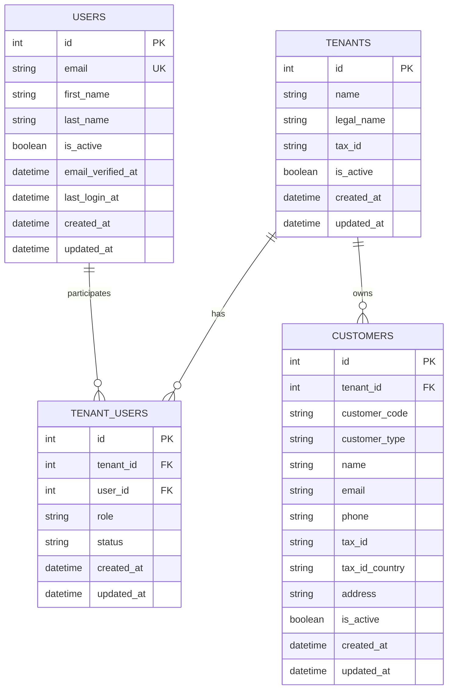

# Data model

This document describes the schema actually implemented by the SQLAlchemy models and Alembic migrations. Future commercial entities are not part of the current database.

## Implemented model

## Entities

### `users`

Represents a person's global identity. Email is required and has case-insensitive uniqueness through a functional index. The user's role is not stored in this table.

### `tenants`

Represents the organization that defines the boundary for commercial data. It has a required name, optional legal data, an active status, and timestamps.

### `tenant_users`

Represents a user's membership in a tenant. The combination of `tenant_id` and `user_id` is unique. `role` accepts `ADMIN` or `OPERATOR`; `status` accepts `ACTIVE` or `SUSPENDED`.

### `customers`

Represents a person or organization served commercially. Each customer belongs to a tenant and may be identified as `INDIVIDUAL` or `COMPANY`.

`customer_code` is required, normalized to uppercase by the model, and unique without case sensitivity within the tenant. Customers have an active status and should not be physically deleted when historical records exist.

## Database-enforced integrity

The migrations enforce:

- primary keys on all four tables;
- foreign keys between memberships, users, and tenants;
- a foreign key from customers to tenants;
- `ON DELETE RESTRICT` on the existing references;
- one membership per user and tenant;
- membership roles and statuses limited to the defined values;
- customer types limited to `INDIVIDUAL` and `COMPANY`;
- nonblank customer codes;
- case-insensitive customer-code uniqueness within a tenant;
- paired presence of `tax_id` and `tax_id_country`.

## Application-level validation

Uppercase normalization of `customer_code` and default values are SQLAlchemy-model behavior. No Pydantic HTTP schemas or customer HTTP validation exist yet.

Country-specific tax-identifier format validation, external verification, authorization, and API-level tenant isolation are not implemented.

## Future entities

The domain includes, but the current database does not yet have:

- categories, products, and price lists;
- stock balances and movements;
- orders and order items;
- receivables and payments;
- specific commercial audit records;
- dashboard indicators.

These entities should produce models and migrations only when their respective flow is approved and implemented.
